# Kaitai Interactive SVG

Kaitai Struct의 `.ksy` 파일을 **독립 SVG**로 변환하는 Python 프로그램입니다.
기본 출력은 정적 SVG이며, `--interactive`로 문서 툴팁·연결선 강조·확대·이동
기능을 활성화합니다.



*SQLite 예제. 생성 명령은 [빠른 시작](#빠른-시작)에 있습니다.*


## 빠른 시작

Python 3.11 이상이 필요합니다. 저장소에서 `uv`로 의존성을 설치하고, 포함된
SQLite 예제를 변환할 수 있습니다.

```sh
uv sync --locked

uv run kaitai-svg examples/sqlite3.ksy \
    --interactive \
    --color-type-edges \
    --router orthogonal \
    --layout optimized-with-space \
    --hide vlq_base128_be.ksy \
    --layout-width 6000
```

SVG는 입력 `.ksy` 파일 옆에 같은 이름으로 저장됩니다.

```sh
uv run kaitai-svg path/to/schema.ksy
uv run kaitai-svg "schemas/**/*.ksy" -I ./format-library
uv run kaitai-svg "schemas/**/*.ksy" --out-dir ./output
```

`--out-dir DIR`을 지정하면 입력 파일의 디렉터리 구조와 관계없이 해당 폴더에
`<입력 파일명>.svg`로 저장합니다. 폴더가 없으면 상위 폴더까지 자동으로
생성하며, 상대 경로는 현재 작업 디렉터리를 기준으로 합니다. 여러 입력의 출력
파일명이 겹치면 해당 입력들은 건너뛰고 오류를 보고하며, 나머지는 변환합니다.
기존 SVG는 검증과 렌더링에 성공한 뒤 원자적으로 교체합니다.

`uv`를 사용하지 않는 경우 저장소에서 `python -m pip install .`을 실행한 뒤
`kaitai-svg` 명령을 사용할 수 있습니다. `python -m kaitai_svg`와
`kaitai-interactive-svg`도 같은 CLI입니다.

기본 정적 SVG에는 JavaScript, 조작 버튼, 사용자 지정 툴팁, Tab 포커스를 넣지
않습니다. 도면 크기를 `width`·`height`와 `viewBox`에 기록하며 글자 선택과
브라우저 기본 스크롤을 사용할 수 있습니다. 문서는 SVG의 `<title>`에 보존하므로
이를 지원하는 뷰어에서 기본 문서 툴팁을 볼 수 있습니다. `--interactive`는 아래
연결선 표시 옵션과 독립적으로 사용할 수 있습니다.

import와 중첩 정의 연결선은 기본적으로 그리지 않습니다. `--show-imports`로
주황색 import 선을, `--show-nested-types`로 부모와 중첩 타입·enum 사이의
청록색 선을 각각 표시합니다. 해당 범례도 함께 나타납니다. 두 옵션은 독립적으로
사용할 수 있으며, import 파일 검증·타입/enum 정의 포함·필드 참조선에는 영향을
주지 않습니다.

`--treeshake`를 지정하면 입력 파일에서 참조하지 않는 import 파일의 타입과
enum을 SVG에서 제외합니다. 타입·enum 참조와 표현식에 명시된 `::` 참조를
따라가므로 표시되는 정의의 참조 대상은 계속 표시하고, 중첩 정의가 쓰이면 그
부모 정의도 함께 남깁니다.
입력 파일에 선언된 정의는 모두 표시합니다. 이 옵션은 import 파일의 로딩과
검증에는 영향을 주지 않으며 `--show-imports`, `--show-nested-types`, `--hide`와
함께 사용할 수 있습니다.

`--hide <id>|<filename>`으로 타입·enum·필드·매개변수·인스턴스·enum 값을
렌더링에서 제외합니다. 옵션을 여러 번 지정하면 모든 대상을 함께 숨깁니다. ID는
`text_payload`, `packet::text_payload`, `packet::text_payload::text`처럼
지정하며, 짧은 ID는 일치하는 모든 요소에 적용됩니다. SVG의
`data-node-id`·`data-row-id`도 사용할 수 있습니다. `.ksy` 파일명을 지정하면 그
파일의 모든 정의를 숨깁니다. 파일명만 쓰면 같은 이름의 모든 파일에 적용되고,
디렉터리가 있는 경로로 특정 파일을 지정할 수 있습니다. 경로는 입력 스키마의
디렉터리 기준이며, 현재 작업 디렉터리에서 존재하는 경로나 절대 경로도
받습니다.

숨긴 요소에 붙은 연결선과 비어 있는 파일 그룹도 제외한 뒤 배치합니다. 타입을
숨겨도 그 안에서 선언한 중첩 타입은 별도 정의로 남으며, 숨긴 타입을 참조하는
다른 요소의 필드는 그대로 표시합니다. 일치하지 않는 대상은 무시하고, 숨긴
파일도 import 로딩·검증과 원래 위치·크기 계산에는 포함합니다.
`--interactive`와 다른 표시·라우터 옵션을 함께 사용할 수 있습니다.

`--color-type-edges`로 **Type 참조선마다 서로 다른 색상**을 지정할 수
있습니다. 같은 타입을 참조하는 필드도 연결선별로 색을 배정합니다. 최대 12색을
쓰며, 13번째부터는 같은 팔레트를 순환합니다. 선·화살촉·접점은 같은 색을
사용하며, 정적 SVG와 `--interactive`에서 모두 동작합니다. 연결의 출발
타입·필드·도착 타입·라벨 순으로 배정하므로 import·중첩 정의 표시 옵션을 바꿔도
색상은 유지됩니다.

팔레트는 [OKLab](https://bottosson.github.io/posts/oklab/) 공간에서 기존
색들과의 최소 거리가 가장 큰 후보를 차례로 선택했습니다. sRGB 후보의 지각적
명도는 0.46–0.67, 채도는 0.10–0.24로 제한했으며, 최종 12색의 최소 OKLab 거리는
0.138입니다. 배경·파일 그룹·흰 카드에 대한 대비는 모두 **3.5:1 이상**으로,
[WCAG 비텍스트 대비 기준의
3:1](https://www.w3.org/WAI/WCAG21/Understanding/non-text-contrast.html)을
넘도록 선정했습니다. 이는 일반적인 색각에서의 구분도를 최적화한 것이며, 모든
색각 이상에서 12색 구분을 보장하지는 않습니다. 팔레트와 측정값은
`uv run python -m kaitai_svg.palette`로 재현할 수 있습니다.


### 요소 배치

`--layout <layout-name>`으로 타입·enum 카드와 파일 그룹의 위치를 결정하는
방법을 선택합니다. 연결선 경로를 정하는 `--router`와 독립적으로 지정할 수
있습니다.

| 이름                   | 구현                       | 동작                                                                   |
| ---------------------- | -------------------------- | ---------------------------------------------------------------------- |
| `default`              | `DefaultLayout`            | 기존 파일별 크기 균형 배치. 파일 정보가 없는 그래프는 기존 계층형 배치 |
| `optimized`            | `OptimizedLayout`          | 연결 관계를 고려한 배치 후보를 만들고 실제 라우팅 결과로 비교          |
| `optimized-with-space` | `OptimizedWithSpaceLayout` | 표의 컬럼 폭과 줄바꿈, 카드·열·파일 그룹 사이 간격을 함께 조정         |
| `vertical-optimized`   | `VerticalOptimizedLayout`  | 가로폭을 제한하고 파일 그룹을 세로로 배치해 웹페이지 스크롤에 맞춤     |

```sh
uv run kaitai-svg examples/sqlite3.ksy --layout optimized --router orthogonal
```

기본값은 `default`입니다. `--layout default --router default`는 기존 출력을
유지합니다. `optimized`는 같은 파일의 요소를 그룹 안에 유지하면서 카드의
순서·열 배정과 파일 그룹의 위치를 연결 관계에 맞춰 조정합니다. 타입 내부의
`params`·`seq`·`instances`와 enum 행 순서는 바꾸지 않습니다.

처리 순서는 **표 크기 측정과 포트 공간 확보 → 배치 → 실제 행·헤더 포트 계산
→ 선택한 라우터로 경로 계산 → SVG 생성**입니다. `optimized`에서는 빠른
근사 평가로 후보를 추린 뒤, 후보마다 포트와 경로를 다시 계산해 실제 공유
선분·교차·꺾임·길이를 비교합니다. 기본 구현은 카드·열·패널의 지역 변경을
최대 64개 검토하고, 기존 배치와 근사 점수가 좋은 후보 3개까지 합쳐 **최대
4개 배치를 실제 라우팅**합니다. 노드 겹침 방지와 파일 그룹 제목 영역의
여백을 유지합니다.

`optimized`의 최종 선택은 **공유 선분 길이 → 교차 수 → 꺾임 수 → 경로 길이 → 화면
면적** 순서로 비교합니다. 앞선 값이 같을 때만 다음 값을 고려하므로,
동일한 라우터를 사용한 기존 배치보다 이 비교 기준이 나빠지지 않습니다.
면적은 마지막 기준이어서 연결선을 단순하게 만드는 대신 화면이 더 넓어질
수 있습니다.

화면 면적과 읽기 편한 표를 함께 고려하려면 `optimized-with-space`를 사용합니다.
카드 안의 `pos`·`size`·`type`·`id` 컬럼 폭을 내용에 맞춰 배분하고, 바뀐 폭으로
제목·셀·상세 설명을 다시 줄바꿈한 뒤 행 높이와 연결 포트를 계산합니다.
카드 열 수와 배정, 카드·열·파일 그룹 사이 간격도 연결 관계와 혼잡도에 맞춰
조정합니다. 글자 크기와 의미상 행 순서는 유지합니다.
간격은 같은 통로에서 연결선 구간이 동시에 겹치는 정도로 계산합니다.
높이가 다른 구간의 연결선은 통로를 재사용하고, 긴 참조는 실제로 꺾이는
위치에 공간을 확보합니다. 카드별 세로 위치도 참조하는 행과 대상 헤더의
포트에 맞춰 조정합니다. 혼잡한 배치는 여러 간격 후보를 실제 라우팅해 비교합니다.

```sh
uv run kaitai-svg examples/sqlite3.ksy --layout optimized-with-space --router orthogonal
uv run kaitai-svg examples/sqlite3.ksy --layout optimized-with-space --layout-width 1440 --router orthogonal --interactive
uv run kaitai-svg examples/sqlite3.ksy --layout optimized-with-space --layout-width 4000 --router orthogonal
```

폭을 생략하면 고정 가로폭 제한 없이 도면 크기를 자동 선택합니다.
`--layout-width PIXELS`를 지정하면 **실제 라우팅 후의 SVG 전체 폭**을 해당 값
이하로 제한합니다. 파일 테두리·연결선 우회 공간·바깥 여백까지 포함하며,
지정한 폭을 가용 공간으로 삼아 열 수를 늘리고 도면 높이를 줄이는 후보를
비교합니다. 열 수는 카드 수·측정 폭·필요한 통로 공간에 따라 결정하며,
2열이나 4열로 제한하지 않습니다. 실제 도면 폭은 지정한 값보다 좁을 수 있습니다.
최소 680px이 필요합니다. 읽기 위한 최소 폭이나 연결선 공간을 확보할 수
없으면 오류를 내고 기존 출력 파일을 유지합니다. 이 모드는 일반 배치와 같은
정적·interactive 표시 방식을 사용하며, 웹페이지 세로 스크롤 동작은
`vertical-optimized`에서 제공합니다.

자연 측정 폭의 **85%·100%·125%** 프로필을 읽기 위한 최소 폭과 일반 타입
카드 900px·enum 카드 550px의 최대 폭 안에서 비교합니다. 내용에 따라 컬럼을
재배분하고 실제 줄바꿈 높이를 계산하므로, 폭을 늘려 불필요한 줄바꿈을 줄이거나
폭을 줄여 여러 카드를 더 조밀하게 배치할 수 있습니다. 빠른 근사 평가는 최대
64개 후보로 제한하고, 서로 다른 폭·열·간격 구성을 포함해 **최대 6개 배치를
실제 라우팅**합니다.

`orthogonal` 라우터와 함께 사용하면 평행한 연결선 사이에 **8px 간격**을
확보하는 경로를 탐색합니다. 포트에 붙는 짧은 선분도 포함하며, 배경 halo와
강조된 선이 이웃 연결선을 가리는 구간을 평가합니다.
연결선 라벨도 전체 경로·카드·파일 제목·다른 라벨을 확인해 빈 위치에 배치합니다.
고정 라우팅 앵커 때문에 선 끝에 생긴 우회는 실제 카드 연결점을 유지하면서
줄입니다. 장애물·선 간격·교차 수를 확인하고, 꺾임과 길이가 함께 줄어드는 경우에만 적용합니다.

최종 선택에서는 **공유 선분 길이 → 평행선 간격 부족량**을 먼저 줄이고,
같은 경우 정규화한 교차 수,
꺾임 수, 경로 길이, 화면 면적, 텍스트 높이의 합을 최소화합니다. 연결선 하나당
교차·꺾임과 자연 측정 카드 크기를 기준으로 경로 길이를 비교하며, 면적은 자연
측정 카드 면적의 합, 텍스트 높이는 기본 폭에서 측정한 줄바꿈 결과를 기준으로 합니다.
폭을 지정한 경우 공간 비용은 가용 폭 × 도면 높이로 계산하여, 넓은 폭을
활용해 높이를 줄이는 배치가 최종 비교에 반영되도록 합니다.
이 때문에 교차가 조금 늘더라도 화면이 크게 작아지는 배치를 선택할 수 있으며,
과도한 줄바꿈으로 카드가 길어지는 배치에는 비용을 부여합니다.

웹페이지처럼 가로폭이 제한되고 세로로 스크롤할 수 있는 화면에는
`vertical-optimized`를 사용합니다. 기본 가로폭 예산은 **1,200px**이며,
`--layout-width`로 변경할 수 있습니다.

```sh
uv run kaitai-svg examples/sqlite3.ksy --layout vertical-optimized --router orthogonal
uv run kaitai-svg examples/sqlite3.ksy --layout vertical-optimized --layout-width 960 --router orthogonal
uv run kaitai-svg examples/sqlite3.ksy --layout vertical-optimized --layout-width 1440 --router orthogonal --interactive
```

파일 그룹은 위아래로 쌓고, 그룹 안의 카드 열 수와 순서를 가용 폭과 연결 관계에
맞춰 조정합니다. 표의 행 순서와 측정된 글자 크기는 유지합니다. 폭 예산에는
카드·파일 테두리뿐 아니라 연결선 우회 공간과 바깥 여백도 포함합니다. 폭에 맞는
후보 중 최대 4개를 실제 라우팅해 연결선 품질을 비교하고, 품질이 같으면 높이가
작은 배치를 고릅니다. 높이에 상한은 두지 않으며, 최종 SVG는 예산보다 좁을
수 있습니다.

`--layout-width PIXELS`는 `vertical-optimized`와 `optimized-with-space`에서
사용하는 양의 정수 값입니다. `vertical-optimized`에서는
상단 설명 영역 때문에 최소 680px이 필요하며, 측정된 카드와 필요한 여백을
담기에 너무 좁으면 필요한 폭을 안내하는 오류를 냅니다.
글자나 표를 억지로 줄여 넣지 않으므로 긴 식별자·표현식이 있는 스키마는 더 넓은
폭이 필요할 수 있습니다.

이 배치의 정적·interactive SVG는 `max-width: 100%; height: auto`로 페이지
폭에 맞추며, 세로 전체를 스크롤할 수 있는 높이를 유지합니다. 지정한 폭은 SVG
좌표 기준의 명목상 픽셀 값입니다. 좁은 화면에서는 SVG 전체가 축소되며,
브라우저에서 카드가 다시 배치되지는 않습니다. 배치 자체를 바꾸려면 허용되는
폭 범위에서 `--layout-width` 값을 바꾸어 다시 생성하세요.

세로 배치의 `--interactive`에서는 기본 휠 동작으로 페이지를 스크롤하고,
**Ctrl/Command + 휠**로 도면을 확대·축소합니다. 마우스 드래그로 도면을 이동할
수 있으며, 터치에서는 세로 스크롤과 브라우저의 핀치 확대를 사용합니다.

인터페이스 `LayoutEngine`과 구현은
[`src/kaitai_svg/placement.py`](src/kaitai_svg/placement.py)에 있습니다.
외부 실행 파일 없이 동작하며 같은 입력과 옵션에는 같은 결과를 만듭니다.
여러 후보를 라우팅하므로 `default`보다 느릴 수 있고, 전역 최적해나 모든
지표의 동시 개선을 보장하지는 않습니다. `--layout optimized --router default`와
`--layout default --router orthogonal`도 사용할 수 있습니다.

SQLite 예제의 15개 카드·24개 연결선을 `orthogonal` 라우터로 비교한 실행
결과는 다음과 같습니다. import·중첩 정의 연결은 기본값대로 숨겼으며,
계산 시간은 실행 환경에 따라 달라집니다. 길이와 크기는 SVG 좌표 기준이며,
화면 크기는 반올림했습니다.

| 배치                   | 공유 선분 길이 | 교차 수 | 꺾임 수 | 경로 길이 | 화면 크기     | 계산 시간  |
| ---------------------- | -------------- | ------- | ------- | --------- | ------------- | ---------- |
| `default`              | 0              | 71      | 98      | 41,932.25 | 2,232 × 2,189 | 약 2.01초  |
| `optimized`            | 0              | 30      | 62      | 27,004.75 | 4,474 × 2,177 | 약 3.88초  |
| `optimized-with-space` | 0              | 25      | 82      | 21,767.05 | 3,671 × 1,391 | 약 14.84초 |
| `vertical-optimized`   | 0              | 38      | 96      | 35,767.5  | 745 × 5,194   | 약 1.68초  |

`optimized-with-space`는 폭 제한 없이 측정했습니다. `optimized`에 비해 폭은
약 18%, 면적은 약 48% 줄었으며, 교차는 5개 줄고 꺾임은 20개 늘었습니다.

세로 배치는 기본 1,200px 예산으로 측정했습니다. 이 예제의 실제 폭은 745px로,
가용 폭을 모두 채우지는 않습니다. `optimized`에 비해 가로폭이 줄어든 대신
도면이 길어지고 교차·꺾임이 늘었습니다.

다음 명령은 SVG 파일을 변경하지 않고 모든 배치의 경로 지표와 화면 크기·계산
시간을 비교합니다. JSON의 `parallel_conflict_length`는 평행선 사이 8px 간격이
부족한 구간의 가중 길이이며, 배경 halo에 가려지는 근접 경로를 확인할 수 있습니다.

```sh
uv run python tests/compare_layouts.py examples/sqlite3.ksy --router orthogonal
```

세로 배치의 비교 폭과 `optimized-with-space`의 최대 폭을 함께 지정하려면
`--layout-width 960`처럼 추가합니다. 기존 `default`·`optimized`의 폭은 유지합니다.


### 연결선 라우터

`--router <router-name>`으로 연결선 경로 계산 방법을 선택합니다. 두 라우터
모두 배치된 노드와 파일 그룹 제목 영역을 피해 수평·수직 경로를 만듭니다.
라우터는 노드를 이동하지 않으며, `--layout optimized`와
`--layout optimized-with-space`·`--layout vertical-optimized`는 선택한 라우터의
결과를 비교해 배치를 고릅니다.
import·중첩 정의 표시, 색상, interactive
옵션과 함께 사용할 수 있습니다.

| 이름         | 구현               | 동작                                                                     |
| ------------ | ------------------ | ------------------------------------------------------------------------ |
| `default`    | `DefaultRouter`    | 기존 희소 격자 A* 라우팅. 옵션을 생략했을 때의 기본값                    |
| `orthogonal` | `OrthogonalRouter` | 추가 우회 트랙과 방향을 고려한 A*, 전체 경로의 혼잡을 평가하는 반복 개선 |

기본값을 `default`로 유지해 기존 출력과 처리 비용을 보존합니다. `orthogonal`은
짧은 연결부터 계산한 뒤 혼잡한 경로를 하나씩 제거하고 다시 찾습니다. 개선
여부는 **공유 선분 길이**를 먼저 비교하고, 같으면 공유 격자점의
접촉(교차·닿음), 꺾임 수, 전체 길이의 가중 비용을 비교합니다. 포트에 붙는 고정
선분도 평가에 포함하며, 이 목적값이 좋아지는 변경만 채택합니다. 같은 입력과
옵션에는 결정적으로 같은 경로를 만듭니다.

기본 `OrthogonalRouter`의 개선 단계는 최대 2회이며, 연결당 A* 탐색은 최초
계산을 포함해 최대 3회입니다. 추가 격자와 반복 평가 때문에 `default`보다 계산
시간과 메모리가 늘 수 있습니다. 전체 최적해, 교차 제거, 모든 그래프에서 기존
라우터보다 나은 결과를 보장하지 않으므로 도면에 맞춰 선택하세요.

인터페이스와 구현은 [`src/kaitai_svg/routing.py`](src/kaitai_svg/routing.py)에
있습니다. 꺾임·교차·공유 경로·간격을 함께 고려하는 설계는
[Adaptagrams/libavoid 공식 라우팅 매개변수
문서](https://www.adaptagrams.org/documentation/namespaceAvoid.html)를
참고했습니다. 이 프로젝트는 자체 Python 라우터를 사용하며 libavoid나 외부 실행
파일에 의존하지 않습니다.

라우터별 교차 수·공유 선분 길이·꺾임 수·경로 길이·계산 시간은 다음 명령으로
비교할 수 있습니다. 결과는 입력과 실행 환경에 따라 달라집니다. 모든 관계를
포함하려면 `--show-imports --show-nested-types`를 추가하세요.

```sh
uv run python tests/compare_routers.py examples/sqlite3.ksy
```


## SVG 보기

생성한 SVG를 브라우저에서 직접 여세요.

-   `--interactive`로 생성하면 타입과 필드에 마우스를 올리거나 Tab으로
    포커스를 이동할 때 해당 `doc`을 표시합니다.
-   타입 이름·식별자·위치·크기·표현식에는 Cascadia Mono / Consolas 계열
    monospace를 사용하고, 문서 툴팁과 설명에는 Segoe UI 계열 산세리프를
    사용합니다. 한글 대체 글꼴과 각 글꼴의 폭을 고려해 줄바꿈합니다.
-   각 타입을 `pos | size | type | id` 표로 표시하고, 헤더의 **SEQ SIZE**에
    순차 읽기 크기를 표시합니다. 조건, 반복, switch 분기와 인스턴스 표현식은
    해당 행 아래에 표시합니다.
-   같은 `.ksy` 파일에서 온 타입과 enum은 파일명 테두리 안에 모읍니다. 타입
    내부는 `params`, `seq`, `instances` 구역으로 나눕니다. enum은 `value | id`
    두 컬럼만 표시하고 위치·크기 컬럼과 SEQ SIZE 배지는 생략합니다.
-   타입 참조와 enum 참조를 서로 다른 연결선으로 나타냅니다. import 선은
    `--show-imports`, 부모와 중첩 정의 사이의 선은 `--show-nested-types`
    옵션을 지정했을 때만 나타납니다.
-   옵션으로 표시한 import는 **주황색 파선 + 열린 화살표**, 중첩 타입은
    **청록색 실선 + 부모 쪽 빈 마름모**로 구분합니다. interactive 모드에서
    호버·포커스로 강조해도 관계의 색상과 선 모양은 유지됩니다.
-   연결마다 접점과 경로를 분리하고, 선이 교차하는 곳은 배경색 간격으로
    구분합니다. 상단 범례로 연결 종류를 구별합니다. interactive 모드에서는
    필드에 마우스를 올리거나 포커스를 주면 그 필드의 연결만 강조합니다.
    연결선을 호버하거나 Tab으로 포커스를 주면 연결 라벨과 출발·도착 타입
    문서를 표시합니다.
-   interactive 모드에서 휠로 확대/축소하고 드래그로 이동할 수 있습니다.
    `vertical-optimized`에서는 기본 휠로 페이지를 스크롤하며
    Ctrl/Command + 휠로 확대/축소합니다. SVG 안의 초기화 버튼으로 전체 보기를
    복원합니다.


### 표의 위치와 크기

| 표시                       | 의미                                                                        |
| -------------------------- | --------------------------------------------------------------------------- |
| `pos: 2`                   | 타입 시작 기준 바이트 오프셋 2                                              |
| `pos: 1.5`                 | 1바이트와 5비트를 읽은 위치. 소수점 숫자가 아닌 `byte.bit` 표기             |
| `size: 2 B`, `size: 5 bit` | 해당 필드가 읽는 바이트 수 또는 비트 수                                     |
| `18–22 B`                  | 조건에 따른 최소·최대 크기 범위. 범위 안의 모든 길이가 가능하다는 뜻은 아님 |
| `count × 4 B`, `length B`  | 원문 표현식에 의존하는 길이                                                 |
| `?`, `to EOS`, `variable`  | 정적으로 확정할 수 없는 길이, 스트림 끝까지, 가변 반복                      |
| `—`                        | 바이트를 읽지 않는 매개변수·계산 인스턴스 또는 enum 값                      |

기본 타입, 고정 `size`·`contents`, 참조 타입, 비트 필드, 상수 반복은 정적으로
계산합니다. 바이트 읽기 전 정렬은 [Kaitai의 비트 필드
규칙](https://doc.kaitai.io/user_guide.html#_bit_sized_integers)을 따릅니다.
`instances`의 `pos`는 KSY에 지정된 스트림 기준 식을 그대로 표시하며, 재읽기
크기는 **SEQ SIZE**에 더하지 않습니다. enum의 `value` 칸에는 숫자 값을
표시합니다. 표현식을 실행하거나 실제 바이너리를 읽지 않으므로, 조건과 재귀
등에서 계산할 수 없는 값은 확정된 숫자로 표시하지 않습니다.


## 검증과 import

모든 입력과 재귀적으로 불러온 import를 [Kaitai 공식 JSON
Schema](https://github.com/kaitai-io/ksy_schema)로 검증합니다.

JSON Schema에 더해 중복 YAML 키, 누락된 `meta.id`, 알 수 없는 타입/enum 참조,
중복 식별자, 반복 표현식 누락도 검사합니다. 오류에는 파일 경로와 문제가 있는
스키마 위치를 표시합니다. **Kaitai 표현식의 문법 및 타입 전체를 컴파일러처럼
검사하거나 바이너리 파일을 해석하지는 않습니다.** 표현식은 원문으로
표시합니다.

```yaml
meta:
  id: packet
  imports:
    - common           # 현재 .ksy 디렉터리의 common.ksy
    - /network/header  # -I 또는 KSPATH의 network/header.ksy
seq:
  - id: header
    type: header
    doc: 패킷의 헤더입니다.
  - id: payload
    type: common::payload
```

상대 import는 **import를 선언한 파일의 디렉터리**를 기준으로 찾습니다. `/`로
시작하는 라이브러리 import는 `-I`를 지정한 순서, 이어서 `KSPATH` 순서로
찾습니다. `KSPATH` 구분자는 Windows에서 `;`, Linux에서 `:`입니다. import
이름에서는 `.ksy` 확장자를 생략합니다. import 순환과 자기 참조 타입을
처리하며, 불러온 타입도 같은 SVG에 포함합니다. import 파일 자체의 별도 SVG가
필요하면 해당 파일도 glob 또는 인자로 입력하세요.


## Python API

```python
from pathlib import Path
from kaitai_svg import convert
from kaitai_svg.loader import load_graph
from kaitai_svg.render import render_svg

source = Path("examples/sqlite3.ksy")
output = convert(
    source, interactive=True, layout="optimized", router="orthogonal",
    color_type_edges=True, hide=["vlq_base128_be.ksy"], treeshake=True,
    out_dir="output",
)

# SVG 문자열만 필요한 경우
graph = load_graph(source)
svg_text = render_svg(graph, interactive=True)
```

`convert`와 `render_svg`에는 CLI의 `show_imports`, `show_nested_types`,
`color_type_edges`, `layout`, `layout_width`, `router`, `hide`, `treeshake` 옵션을 같은 이름의 키워드 인수로 전달할
수 있습니다. import 검색 경로는 `convert`와 `load_graph`의 `import_paths`로
지정합니다. `layout="default"`, `router="default"`가 기본값이며 등록되지 않은
이름은 `ValueError`를 발생시킵니다. Python API에는 이름 대신 구체적인
`LayoutEngine` 또는 `Router` 하위 **클래스**도 전달할 수 있습니다.

```python
from pathlib import Path
from kaitai_svg import OptimizedLayout, OrthogonalRouter, convert

output = convert(
    Path("examples/sqlite3.ksy"),
    layout=OptimizedLayout,
    router=OrthogonalRouter,
)
```

가로폭을 지정하는 세로 배치도 이름이나 `VerticalOptimizedLayout` 클래스로
선택할 수 있습니다. `layout_width`를 생략하면 1,200을 사용하며,
세로 배치에서만 지정할 수 있습니다. Python API는 유한한 양수 픽셀 값을 받으며,
최소 폭은 CLI와 같습니다.

```python
output = convert(
    Path("examples/sqlite3.ksy"),
    layout="vertical-optimized",
    layout_width=960,
    router="orthogonal",
)

svg_text = render_svg(
    graph, layout="vertical-optimized", layout_width=960, router="orthogonal",
)
```

```python
from pathlib import Path
from kaitai_svg import OrthogonalRouter, convert


class CustomRouter(OrthogonalRouter):
    # 기존 장애물 회피 구현을 상속하고 비용 가중치만 조정합니다.
    bend_penalty = 70
    crossing_penalty = 240


output = convert(Path("examples/sqlite3.ksy"), router=CustomRouter)
```

`LayoutEngine`을 직접 구현할 때는 `placements(graph, nodes)`에서
`kaitai_svg.placement.Placement`의 유한 목록을 반환합니다. 각 후보의
`positions`에는 입력 노드 순서대로 `(x, y)`를 하나씩, `groups`에는 해당
후보의 파일 그룹 사각형과 제목 정보를 넣습니다. `nodes`에는 표 측정과 포트
공간 확장이 끝난 치수가 전달됩니다. 기본적으로 크기·행 순서를 보존하고
카드·그룹의 충돌과 제목 침범을 방지해야 합니다. 폭을 다시 측정하는 엔진은
`Placement.nodes`에 독립적인 측정 결과를 선택적으로 넣을 수 있습니다.
원본 `Node` 객체와 입력 노드 순서, 의미상 행 순서를 유지하고, 배치 전에
새 행·헤더 치수에 필요한 포트 공간도 확보해야 합니다. 기존 두 인자 생성자는
계속 사용할 수 있습니다. 후보마다 새 라우터를 생성하며, 선택한 후보의
표·행·그룹 치수와 좌표·연결선을 함께 SVG에 반영합니다.

후보별 측정 정보를 평가하려면 `score_placement(metrics, width, height, placement)`를
재정의합니다. 기본 구현은 기존 `score(metrics, width, height)`에 위임합니다.
완성된 연결선 좌표까지 평가하려면
`score_routes(metrics, width, height, placement, paths)`를 재정의합니다.
기본 구현은 `score_placement()`에 위임합니다.

`Router`를 직접 구현할 때는 추상 메서드
`__init__(nodes, anchors, groups=None)`와 `route(start, end)`를 구현합니다.
인스턴스는 도면마다 새로
생성되며, `anchors`에는 각 연결의 시작·끝 좌표가 입력 순서대로 들어 있습니다.
`route`는 두 앵커를 포함하는 수평·수직 점 목록을 반환하고 다음 연결을 위해
사용 경로를 예약합니다. 노드 사각형과 파일 그룹 제목 영역을 장애물로 취급해야
합니다.

출발 앵커는 출발 노드 오른쪽 포트에서 **x + 18**, 도착 앵커는 도착 노드 왼쪽
포트에서 **x − 18**에 있습니다. `layout_graph`가 포트와 앵커 사이의 고정 수평
선분을 앞뒤에 붙입니다. 사용자 라우터도 이 선분의 방향과 장애물 회피를
유지해야 합니다. `route_all(connections)`의 기본 구현은 입력 순서대로
`route`를 호출합니다. 전체 최적화를 위해 재정의하면 내부 탐색 순서를 바꿀 수
있지만, 반환값은 **입력 순서와 같은 순서로 연결당 경로 하나씩**이어야 합니다.
사용자 클래스는 Python API에서 전달하며 CLI는 `ROUTERS`에 등록된 이름만
받습니다.


## 개발 및 테스트

```sh
uv sync --locked
uv run python -m unittest discover -s tests -v
uv build
```

표준 테스트는 `unittest`를 사용하며, 포함된 SQLite 스키마와 상대 import의
변환도 검사합니다. Node.js가 설치되어 있으면 생성된 SVG 스크립트의 상호작용
검사를 추가로 실행합니다. Node.js가 없으면 해당 검사만 건너뜁니다.

세로 배치 기능 추가 후 Windows/Python 3.12에서 단위 테스트 160개와 wheel·소스
배포물 빌드, wheel의 배치 이름·클래스 선택 검사를 통과했습니다. 기본 배치는
두 예제에서 이전 코드의 좌표·연결선과 일치하며, 예제별 16개 표시 옵션의 SVG
문자열도 일치했습니다. Chromium 156 / Firefox 157에서 두 배치의
정적·interactive 렌더링, 연결 24개·카드 15개, 포커스 강조·문서 툴팁과
JavaScript 오류 부재를 확인했습니다. 이번 배치 검증의 결과와 스크린샷은
`.scratch/layout-qa/`에 있습니다.

세로 배치는 Chromium 156 / Firefox 157에서 기본 1,200px·지정 1,440px,
정적·interactive, 데스크톱·모바일의 16가지 조합을 확인했습니다. 가로 넘침
없이 원래 비율과 세로 높이를 유지하며, 일반 휠 스크롤·Ctrl+휠 확대,
화면 밖 요소로의 키보드 포커스 이동·툴팁 내부 스크롤을 검사했습니다.
Chromium에서는 실제 터치 스와이프도 확인했습니다. 결과와 스크린샷은
`.scratch/vertical-qa/`에 있습니다.

실제 화면과 글꼴, 포인터·키보드 동작은
[Playwright](https://playwright.dev/python/docs/intro) 브라우저 검사로 확인할
수 있습니다. `browser_check.py`는 테스트 fixture와 SQLite 예제의
정적·interactive SVG를 Chromium 또는 Firefox에서 검사합니다.
`browser_type_colors.py`는 연결선 색상과 강조를 확인합니다.
`browser_space_layout.py`는 적응형 배치의 자동·지정 폭, 긴 영문·한글·enum 셀,
실제 글꼴 경계와 키보드·확대 조작을 검사합니다.

```sh
uv run --with playwright==1.64.0 python -m playwright install chromium firefox
uv run --with playwright==1.64.0 python tests/browser_check.py --browser chromium
uv run --with playwright==1.64.0 python tests/browser_check.py --browser firefox
uv run --with playwright==1.64.0 python tests/browser_type_colors.py --browser chromium
uv run --with playwright==1.64.0 python tests/browser_type_colors.py --browser firefox
uv run --with playwright==1.64.0 python tests/browser_vertical_layout.py --browser chromium
uv run --with playwright==1.64.0 python tests/browser_vertical_layout.py --browser firefox
uv run --with playwright==1.64.0 python tests/browser_space_layout.py --browser all --router all
```

결과 JSON과 스크린샷은 Git에서 제외되는 `.scratch/browser-qa/`에 저장됩니다.
적응형 배치 검사의 결과는 `.scratch/space-layout-qa/`에 저장됩니다.
Playwright와 브라우저는 선택형 개발 도구이며 패키지의 실행 의존성이 아닙니다.
